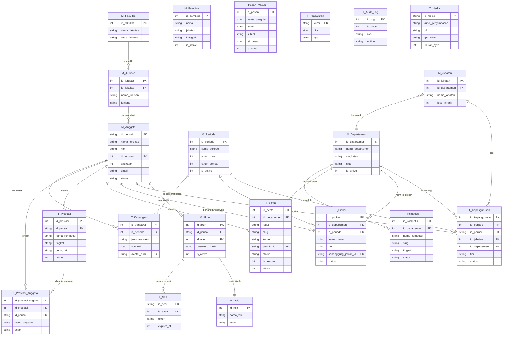

# PERISAI UMI — Reverse Engineering & Architecture Audit

> **Tanggal Audit Awal**: 14 Oktober 2026  
> **Pembaruan Terakhir**: 14 Oktober 2026 (Modernisasi Edge & Cloudflare Workers Ready)  
> **Auditor**: Antigravity (Principal Software Architect & Lead DevOps Mode)  
> **Status Proyek**: Aktif — Siap Produksi Edge (Cloudflare Workers + Turso LibSQL + Cloudflare R2)

---

## 1. Executive Summary & Tech Stack Overview

### 1.1 Ringkasan Eksekutif

**PERISAI UMI Information System** adalah website profil publik + panel admin (CMS) untuk UKM PERISAI (Pusat Pengembangan Riset Mahasiswa) Universitas Muslim Indonesia. Proyek ini merupakan **migrasi penuh** dari stack lama (`PHP 8.2 / Laravel 11 / Blade`) ke stack modern berbasis JavaScript. Arsitekturnya adalah **Fullstack Monolith** dengan pola **Decoupled CMS**, di mana satu aplikasi Next.js melayani halaman publik SSR dan panel admin sekaligus.

Database **digunakan bersama (shared)** dengan sistem PSDM (absensi & data pengurus), sehingga ada constraint ketat: tabel website harus berawalan `web_*` dan tidak boleh memodifikasi tabel milik PSDM.

### 1.2 Tech Stack Utama

| Lapisan | Teknologi | Versi |
|---|---|---|
| **Runtime** | Node.js | `>= 20` (`.nvmrc` → v20) |
| **Framework** | Next.js (App Router) | `^16.3.8` |
| **Bahasa** | TypeScript (strict) | `^5` |
| **UI / Styling** | React 19 + Tailwind CSS v4 | `react@19.2.8`, `tailwindcss@^4.3.3` |
| **ORM / Query** | Prisma Client + Driver Adapters | `^7.10.0` |
| **Database** | SQLite / Turso (LibSQL) | SQLite 3 / libsql cloud |
| **Edge Deployment** | Cloudflare Workers via OpenNext | `@opennextjs/cloudflare@^1.20.11` |
| **Object Storage** | Cloudflare R2 (S3-compatible) | via `@aws-sdk/client-s3` |
| **Validasi** | Zod | `^4.6.5` |
| **CAPTCHA** | Cloudflare Turnstile | API-based |
| **Linter** | ESLint | `^9` |
| **Test Runner** | tsx (Node built-in test runner) | `^4.19.3` |

### 1.3 Dependency Kunci & Fungsinya

| Package | Fungsi |
|---|---|
| `@prisma/client` | ORM TypeScript — query builder tipe-aman |
| `@prisma/adapter-libsql` | Adapter agar Prisma dapat terhubung ke Turso/LibSQL di edge |
| `@prisma/adapter-better-sqlite3` | Adapter Prisma untuk SQLite lokal (dev offline) |
| `@libsql/client` | LibSQL HTTP/WebSocket client untuk Turso Cloud |
| `better-sqlite3` | SQLite native binding untuk dev lokal |
| `@aws-sdk/client-s3` | SDK AWS S3-compatible, digunakan untuk upload ke Cloudflare R2 |
| `@opennextjs/cloudflare` | Build adapter Next.js → Cloudflare Workers |
| `wrangler` | CLI deploy Cloudflare Workers |
| `zod` | Schema validation & type inference (request body, env vars) |
| `pg` + `@prisma/adapter-pg` | Driver PostgreSQL (tersedia tetapi tidak dipakai produksi—legacy artifact) |

### 1.4 Arsitektur Dasar

```
┌─────────────────────────────────────────────────────────────┐
│              FULLSTACK MONOLITH — Next.js App Router        │
│                                                             │
│  ┌──────────────────┐    ┌────────────────────────────────┐ │
│  │  PUBLIC WEBSITE  │    │      ADMIN CMS PANEL           │ │
│  │  (SSR/ISR)       │    │      (/admin/*)                │ │
│  │  /(public)/      │    │  Auth: Cookie Session          │ │
│  └──────────────────┘    └────────────────────────────────┘ │
│            │                          │                     │
│            └──────────┬───────────────┘                     │
│                       ▼                                     │
│              Next.js Route Handlers (API)                   │
│              /api/auth/*, /api/media, /api/health           │
│                       │                                     │
│               ┌───────▼───────┐                             │
│               │  Prisma ORM   │                             │
│               │  (LibSQL adapter)                           │
│               └───────┬───────┘                             │
└───────────────────────┼─────────────────────────────────────┘
                        ▼
              ┌─────────────────┐        ┌──────────────────┐
              │  Turso (LibSQL) │        │  Cloudflare R2   │
              │  = psdm-db.db   │        │  (Object Storage)│
              └─────────────────┘        └──────────────────┘
```

**Pola**: Fullstack Monolith + Decoupled CMS + Edge-first Deployment.

---

## 2. Directory & Component Mapping

### 2.1 Struktur Direktori Utama

```
InformationPerisai-System/
├── .env.example            # Template environment variables
├── .nvmrc                  # Versi Node.js yang dibutuhkan (v20)
├── AGENTS.md               # Aturan untuk AI coder
├── next.config.ts          # Konfigurasi Next.js (rewrites, redirects, image domains)
├── open-next.config.ts     # Konfigurasi adapter Cloudflare Workers
├── postcss.config.mjs      # PostCSS (untuk Tailwind v4)
├── prisma.config.ts        # Konfigurasi Prisma (datasource fallback ke SQLite lokal)
├── wrangler.jsonc          # Konfigurasi deploy Cloudflare Workers
├── tsconfig.json           # Konfigurasi TypeScript
├── eslint.config.mjs       # Konfigurasi ESLint
│
├── prisma/                 # Prisma schema & seed data
│   ├── schema.prisma       # ⭐ Model data tunggal (16 model, 420 baris)
│   ├── seed.ts             # Data awal (periode aktif + pengaturan situs)
│   └── seed_content.ts     # Data konten lebih lengkap (artikel, galeri, dll.)
│
├── db/                     # Manajemen migrasi manual
│   ├── guard.mjs           # Penjaga skema: cek apakah SQL aman dijalankan
│   ├── migrate-turso.mjs   # Script eksekusi migrasi ke Turso Cloud
│   ├── migrations/
│   │   └── 002_complete_perisai_schema.sql  # SQL migrasi utama
│   ├── protected-schema.snapshot.json       # Snapshot skema PSDM (tabel yang dilindungi)
│   └── README.md           # Panduan penggunaan db/guard.mjs
│
├── src/
│   ├── app/                # Next.js App Router
│   │   ├── (public)/       # Route grup: halaman publik (tanpa layout admin)
│   │   │   ├── page.tsx    # Halaman beranda (Home)
│   │   │   ├── kabar/      # Halaman berita/artikel
│   │   │   ├── peluang/    # Halaman kompetisi & peluang
│   │   │   ├── tentang/    # Halaman tentang organisasi
│   │   │   └── kontak/     # Halaman formulir kontak
│   │   ├── admin/          # Route grup: panel admin CMS
│   │   │   ├── login/      # Halaman login admin
│   │   │   └── (panel)/    # Route grup: halaman panel (butuh auth)
│   │   │       ├── page.tsx          # Dashboard admin
│   │   │       ├── posts/            # CRUD berita/artikel
│   │   │       ├── opportunities/    # CRUD kompetisi/peluang
│   │   │       ├── departments/      # CRUD departemen
│   │   │       ├── members/          # Manajemen anggota
│   │   │       ├── work-programs/    # Program kerja (proker)
│   │   │       ├── gallery/          # Manajemen galeri & media
│   │   │       ├── periods/          # Manajemen periode kepengurusan
│   │   │       ├── inbox/            # Pesan masuk (kontak form)
│   │   │       ├── users/            # Manajemen akun CMS
│   │   │       ├── settings/         # Pengaturan situs
│   │   │       ├── statistics/       # Statistik & laporan
│   │   │       └── audit-log/        # Log audit aktivitas
│   │   ├── api/            # REST API Route Handlers
│   │   │   ├── auth/[...all]/route.ts   # Auth: login, logout
│   │   │   ├── media/route.ts           # Upload file media
│   │   │   └── health/                  # Health check endpoint
│   │   ├── layout.tsx      # Root layout (global metadata, font)
│   │   ├── globals.css     # Global CSS + Tailwind base
│   │   ├── robots.ts       # Konfigurasi robots.txt (Next.js API)
│   │   └── sitemap.ts      # Sitemap XML dinamis
│   │
│   ├── components/         # Komponen UI yang dapat digunakan ulang
│   ├── features/           # Modul fitur terorganisasi (14 feature folders)
│   ├── lib/                # Library utilities & integrasi
│   │   ├── auth.ts         # Logika sesi (getSession, cookie management)
│   │   ├── db.ts           # Prisma client singleton (lazy proxy)
│   │   ├── permissions.ts  # RBAC: fungsi can(user, action, resource)
│   │   ├── audit.ts        # Penulis audit log ke T_Audit_Log
│   │   ├── cloudflare.ts   # Purge Cloudflare Cache via API
│   │   ├── env.ts          # Validasi & ekspor environment variables
│   │   ├── images.ts       # Optimasi gambar ke WebP (via sharp)
│   │   ├── mailer.ts       # Abstraksi pengiriman email (SMTP stub)
│   │   ├── rate-limit.ts   # In-memory rate limiter
│   │   ├── sanitize.ts     # Sanitasi HTML (anti-XSS dasar)
│   │   ├── slug.ts         # Generator slug URL
│   │   ├── turnstile.ts    # Verifikasi Cloudflare Turnstile CAPTCHA
│   │   ├── youtube.ts      # YouTube utility (embed URL, thumbnail)
│   │   ├── seo.ts          # Helper generate metadata SEO
│   │   ├── dates.ts        # Format tanggal (unix → string)
│   │   ├── legacy-redirects.ts  # Redirect URL dari sistem Laravel lama
│   │   └── storage/        # Abstraction layer penyimpanan file
│   │       ├── index.ts    # Factory: getStorageDriver() → local | S3/R2
│   │       ├── s3.ts       # Driver: Cloudflare R2 / AWS S3
│   │       └── local.ts    # Driver: disk lokal (/public/uploads)
│   ├── proxy.ts            # Edge-compatible DB proxy untuk Cloudflare Workers
│   └── types/
│       └── index.ts        # Definisi tipe TypeScript global
│
├── scripts/
│   └── test-connections.ts # Script cek konektivitas DB & storage
├── tests/                  # Unit/integration tests (tsx test runner)
├── public/                 # Aset statis (favicon, ikon)
└── deploy/                 # Skrip deploy (shell scripts)
```

### 2.2 Entry Points Aplikasi

| Entry Point | Deskripsi |
|---|---|
| `src/app/layout.tsx` | Root layout SSR — titik masuk utama Next.js App Router |
| `src/app/(public)/page.tsx` | Homepage publik (53 KB — komponen besar) |
| `src/app/admin/login/` | Login page admin |
| `src/app/api/auth/[...all]/route.ts` | API handler autentikasi |
| `.open-next/worker.js` | Entry point Cloudflare Workers setelah build |
| `db/guard.mjs` | CLI tool pengaman migrasi database |

---

## 3. Database Architecture & ERD (Mermaid)

### 3.1 Informasi Database

| Atribut | Detail |
|---|---|
| **Tipe** | SQLite 3 (file) / Turso LibSQL (cloud-hosted SQLite) |
| **File Fisik** | `psdm-db.db` (shared dengan sistem PSDM — tidak di-commit) |
| **Cloud Host** | Turso: `libsql://perisai-dev-psdm.aws-ap-northeast-1.turso.io` |
| **Prisma** | Hanya sebagai **client query builder**, bukan migration manager |
| **Migrasi** | SQL manual di `db/migrations/` dieksekusi via `db/guard.mjs` |
| **ORM Mode** | Driver Adapter Pattern (LibSQL over HTTP/WebSocket di edge) |

#### Konvensi Tabel

- **Tabel PSDM** (dilindungi, read-only): `M_Fakultas`, `M_Jurusan`, `M_Departemen`, `M_Jabatan`, `M_Periode`, `M_Role`, `M_Pembina`, `M_Anggota`, `M_Akun`, `T_Sesi`, `T_Kepengurusan`, `T_Proker`, `T_Berita`, `T_Kompetisi`, `T_Prestasi`, `T_Prestasi_Anggota`, `T_Keuangan`, `T_Pesan_Masuk`, `T_Pengaturan`, `T_Audit_Log`, `T_Media`
- **Konvensi ID**: UUID string (teks) untuk entitas utama; integer autoincrement untuk tabel master PSDM
- **Timestamps**: Unix seconds (integer) — bukan ISO string
- **Booleans**: Integer `0/1`

### 3.2 Katalog Entitas / Tabel

#### Grup 1: Master Data & Referensi (PSDM)

| Tabel (Fisik) | Kolom Kunci | Tipe |
|---|---|---|
| `M_Fakultas` | `id_fakultas` (PK, autoincrement), `nama_fakultas` (unique), `kode_fakultas` | int, str, str? |
| `M_Jurusan` | `id_jurusan` (PK), `id_fakultas` (FK), `nama_jurusan`, `jenjang` | int, int, str, str |
| `M_Departemen` | `id_departemen` (PK), `nama_departemen` (unique), `singkatan`, `slug` (unique), `is_active` | int, str, str, str, int |
| `M_Jabatan` | `id_jabatan` (PK), `id_departemen` (FK?), `nama_jabatan`, `level_hirarki` | int, int?, str, int |
| `M_Periode` | `id_periode` (PK), `nama_periode` (unique), `tahun_mulai`, `tahun_selesai`, `is_active` | int, str, int, int, int |
| `M_Role` | `id_role` (PK), `nama_role` (unique), `label`, `deskripsi` | int, str, str, str? |
| `M_Pembina` | `id_pembina` (PK), `nama`, `gelar`, `jabatan`, `kategori`, `foto_url`, `is_active` | int, str, str?, str, str, str?, int |

#### Grup 2: Keanggotaan & Akun

| Tabel (Fisik) | Kolom Kunci | Tipe |
|---|---|---|
| `M_Anggota` | `id_perisai` (PK, UUID text), `nama_lengkap`, `nim` (unique), `id_jurusan` (FK?), `angkatan`, `gen`, `email` (unique), `no_wa`, `foto_url`, `status` | str, str, str, int?, int, int, str, str?, str?, str |
| `M_Akun` | `id_akun` (PK), `id_perisai` (FK unique), `id_role` (FK), `password_hash`, `is_active`, `last_login` | int, str, int, str, int, int? |
| `T_Sesi` | `id_sesi` (PK, UUID), `id_akun` (FK), `token` (unique), `ip_address`, `user_agent`, `expires_at` | str, int, str, str?, str?, int |

#### Grup 3: Transaksi Kepengurusan

| Tabel (Fisik) | Kolom Kunci | Tipe |
|---|---|---|
| `T_Kepengurusan` | `id_kepengurusan` (PK), `id_periode` (FK), `id_perisai` (FK), `id_jabatan` (FK), `id_departemen` (FK?), `tier`, `status` | int, int, str, int, int?, str, str |
| `T_Proker` | `id_proker` (PK), `id_departemen` (FK), `id_periode` (FK), `nama_proker`, `slug` (unique), `penanggung_jawab_id` (FK?), `foto_cover`, `status` | int, int, int, str, str, str?, str?, str |
| `T_Keuangan` | `id_transaksi` (PK), `id_periode` (FK), `jenis_transaksi`, `kategori`, `nominal`, `tanggal_transaksi`, `bukti_nota`, `dicatat_oleh` (FK?) | int, int, str, str, float, str, str?, str? |

#### Grup 4: Konten Publik

| Tabel (Fisik) | Kolom Kunci | Tipe |
|---|---|---|
| `T_Berita` | `id_berita` (PK), `id_departemen` (FK?), `judul`, `slug` (unique), `kategori`, `konten`, `foto_cover`, `penulis_id` (FK?), `status`, `tanggal_publish`, `is_featured`, `views` | int, int?, str, str, str, str, str?, str?, str, int?, int, int |
| `T_Kompetisi` | `id_kompetisi` (PK), `id_departemen` (FK?), `tipe`, `nama_kompetisi`, `slug` (unique), `tingkat`, `penyelenggara`, `deadline_pendaftaran`, `link_pendaftaran`, `status` | int, int?, str, str, str, str, str, int?, str?, str |
| `T_Prestasi` | `id_prestasi` (PK), `id_perisai` (FK), `nama_kompetisi`, `judul_karya`, `tingkat`, `peringkat`, `tahun`, `foto_dokumentasi` | int, str, str, str?, str, str, int, str? |
| `T_Prestasi_Anggota` | `id_prestasi_anggota` (PK), `id_prestasi` (FK), `id_perisai` (FK?), `nama_anggota`, `peran` | int, int, str?, str, str |

#### Grup 5: Sistem, Pesan & Log

| Tabel (Fisik) | Kolom Kunci | Tipe |
|---|---|---|
| `T_Pesan_Masuk` | `id_pesan` (PK), `nama_pengirim`, `email`, `no_wa`, `instansi`, `tujuan`, `subjek`, `isi_pesan`, `is_read`, `ip_address` | int, str, str, str?, str?, str, str, str, int, str? |
| `T_Pengaturan` | `kunci` (PK, string), `nilai`, `tipe`, `diperbarui_oleh` | str, str?, str, str? |
| `T_Audit_Log` | `id_log` (PK), `id_akun`, `aksi`, `entitas`, `id_entitas`, `data_lama`, `data_baru`, `ip_address` | int, int?, str, str, str?, str?, str?, str? |
| `T_Media` | `id_media` (PK, UUID str), `nama_berkas`, `kunci_penyimpanan` (unique), `url`, `tipe_mime`, `ukuran_byte`, `lebar`, `tinggi`, `diunggah_oleh` | str, str, str, str, str, int, int?, int?, str? |

### 3.3 ERD (Mermaid)



---

## 4. Object Storage & File Handling

### 4.1 Arsitektur Storage

Sistem menggunakan **Strategy/Driver Pattern** — satu interface `StorageDriver` dengan dua implementasi:

```
src/lib/storage/
├── index.ts   ← Factory: membaca STORAGE_DRIVER env → memilih driver
├── s3.ts      ← Driver: Cloudflare R2 / AWS S3 (default produksi)
└── local.ts   ← Driver: Disk lokal /public/uploads (dev/fallback)
```

### 4.2 Flow Upload Media

```
Client (multipart/form-data)
  │
  ▼
POST /api/media
  │  [1] Cek autentikasi (getSession)
  │  [2] Cek izin: can(user, "create", "gallery")
  │  [3] Baca FormData → File
  │  [4] Jika image → processImage() → konversi ke WebP (max 1920px, q=85)
  │  [5] Buat nama file: {timestamp}-{baseName}.webp
  │  [6] storage.upload(buffer, filename, mimeType)
  │  [7] Simpan record ke T_Media (Prisma)
  ▼
Response: { id, storageKey, url, path }
```

### 4.3 Cloudflare R2 (Driver S3)

| Konfigurasi | Nilai / Env Var |
|---|---|
| **Endpoint** | `R2_ENDPOINT` = `https://<ACCOUNT_ID>.r2.cloudflarestorage.com` |
| **Bucket** | `R2_BUCKET` = `perisaiobjectstorage` (nama di produksi) |
| **Access Key** | `R2_ACCESS_KEY_ID` |
| **Secret Key** | `R2_SECRET_ACCESS_KEY` |
| **Public URL** | `R2_PUBLIC_URL` = `https://pub-xxxx.r2.dev` / `https://media.perisai-umi.org` |
| **Region** | `R2_REGION` = `auto` |

**Naming convention key**: `uploads/{timestamp}-{sanitized_baseName}.webp`

**Fallback behaviour**: Jika kredensial R2 tidak tersedia, driver mengembalikan URL representatif lokal `/uploads/{filename}` tanpa error fatal.

### 4.4 Validasi & Batasan File

| Atribut | Detail |
|---|---|
| **Tipe yang didukung** | Semua MIME type; gambar otomatis dikonversi ke WebP |
| **Konversi output** | `image/*` → `image/webp` (via `sharp`, fallback ke buffer asli) |
| **Max width gambar** | 1920px (auto-resize, tanpa enlargement) |
| **Metadata tersimpan** | `kunci_penyimpanan`, `url`, `tipe_mime`, `ukuran_byte`, `lebar`, `tinggi`, `alt_text` |
| **Akses publik** | Direct public URL via R2 public CDN (`r2.dev` / custom domain) |
| **Presigned URL** | Tidak diimplementasikan (semua file bersifat publik) |

---

## 5. API & Authentication Flow

### 5.1 Peta Endpoint

#### API Route Handlers

| Method | Endpoint | Deskripsi | Auth Required |
|---|---|---|---|
| `POST` | `/api/auth/login` | Login admin | ✗ |
| `POST` | `/api/auth/logout` | Logout admin | ✗ |
| `POST` | `/api/media` | Upload file media | ✅ (+ permission gallery) |
| `GET` | `/api/health` | Health check DB & storage | ✗ |

#### Halaman Publik (SSR)

| Route | Deskripsi |
|---|---|
| `/` | Homepage |
| `/kabar` | Daftar berita/kegiatan |
| `/kabar/[slug]` | Detail berita |
| `/peluang` | Daftar kompetisi & peluang |
| `/peluang/[slug]` | Detail kompetisi |
| `/tentang` | Tentang organisasi |
| `/tentang/sumber-daya` | Departemen, proker, galeri |
| `/kontak` | Formulir kontak |

#### Redirect & Rewrite (Legacy Compatibility)

| Source | Destination | Tipe |
|---|---|---|
| `/about` | `/tentang` | Rewrite |
| `/activity` | `/kabar` | Rewrite |
| `/competition` | `/peluang` | Rewrite |
| `/departemen` | `/tentang/sumber-daya#departemen` | Redirect (302) |
| `/program` | `/tentang/sumber-daya#proker` | Redirect (302) |
| `/galeri` | `/tentang/sumber-daya#galeri` | Redirect (302) |

#### Panel Admin (Protected SSR Pages)

| Route | Deskripsi | Role Minimum |
|---|---|---|
| `/admin/login` | Login page | - |
| `/admin` | Dashboard | EDITOR |
| `/admin/posts` | CRUD Berita | EDITOR |
| `/admin/opportunities` | CRUD Kompetisi | EDITOR |
| `/admin/gallery` | Manajemen galeri | EDITOR |
| `/admin/departments` | CRUD Departemen | ADMIN |
| `/admin/members` | Manajemen anggota | ADMIN |
| `/admin/work-programs` | Program kerja | ADMIN |
| `/admin/periods` | Periode kepengurusan | ADMIN |
| `/admin/inbox` | Pesan masuk | ADMIN |
| `/admin/users` | Akun CMS | SUPER_ADMIN |
| `/admin/settings` | Pengaturan situs | SUPER_ADMIN |
| `/admin/statistics` | Statistik | ADMIN |
| `/admin/audit-log` | Log audit | SUPER_ADMIN |

### 5.2 Model Autentikasi & Otorisasi

#### Authentication (Cookie Session — Custom)

Sistem **tidak** menggunakan NextAuth/Auth.js. Autentikasi dibangun **dari scratch** menggunakan:

- **Session identifier**: Cookie `perisai_session_id` berisi `id_perisai` (UUID anggota)
- **Verifikasi password**: Dual-format support:
  1. `scrypt` dengan format `salt:key` (sistem baru)
  2. `SHA-256 hex` (kompatibel dengan seed data lama)
- **Cookie properties**: `httpOnly=true`, `secure=true` (production), `sameSite=lax`, `maxAge=7 hari`
- **Session lookup**: Setiap request melakukan query `M_Anggota` berdasarkan cookie value

> ⚠️ **Catatan arsitektur**: Sesi tidak menggunakan `T_Sesi` untuk lookup (model TSesi ada di skema tapi belum digunakan oleh `getSession()`). Cookie langsung menyimpan `id_perisai` sebagai session identifier.

#### Authorization (RBAC — Custom)

Fungsi `can(user, action, resource)` di `src/lib/permissions.ts`:

```
SUPER_ADMIN → semua aksi & semua resource
ADMIN       → semua, KECUALI:
              - users: create, delete, manage
              - audit_log: selain read
              - settings: manage
EDITOR      → posts, gallery, opportunities: create, read, update
              resource lain: read only
```

### 5.3 Alur End-to-End: Login Admin

```
1. User buka /admin/login → mengisi email/NIM + password
2. Frontend POST /api/auth/login → { email, password }
3. Server: query M_Anggota WHERE email=? OR id_perisai=?
4. Server: verifyPassword(input, storedHash) → scrypt / SHA-256
5. Jika valid: Set-Cookie: perisai_session_id={id_perisai}; HttpOnly
6. Response 200 OK → client redirect ke /admin
```

### 5.4 Alur End-to-End: Upload Media

```
1. Admin di /admin/gallery → pilih file, klik upload
2. Frontend POST /api/media (multipart/form-data, field: "file")
3. Server:
   a. getSession() → validasi cookie
   b. can(user, "create", "gallery") → cek RBAC
   c. file.arrayBuffer() → Buffer
   d. Jika image: processImage() → WebP, max 1920px
   e. storage.upload(buffer, filename) → S3/R2 PUT request
   f. prisma.tMedia.create({ url, mime, size, ... })
4. Response: { id, storageKey, url }
```

---

## 6. External Integrations

| Integrasi | Library / Metode | Tujuan | Status |
|---|---|---|---|
| **Cloudflare R2** | `@aws-sdk/client-s3` (Web Streams / `Uint8Array`) | Object Storage untuk file media | ✅ **Aktif & Teruji Live** (Upload & Delete terverifikasi via `scripts/test-connections.ts`) |
| **Turso / LibSQL** | `@libsql/client` + `@prisma/adapter-libsql` | Database cloud (hosted SQLite) | ✅ **Aktif & Teruji Live** (21 tabel terdeteksi, ping 938ms) |
| **Cloudflare Workers** | `@opennextjs/cloudflare` + `wrangler` | Deployment platform edge (V8 Isolate) | ✅ **Siap Deploy** (Kompatibel OpenNext, `nodejs_compat` aktif, zero native C++) |
| **Sharp** | `import('sharp')` dynamic (dev only) | Kompresi gambar (Node.js dev offline) | ✅ **Diisolasi** (Bypass otomatis di Edge/Production Workers) |
| **Cloudflare Turnstile** | Fetch ke `challenges.cloudflare.com` | Anti-bot CAPTCHA untuk formulir kontak | ✅ Implementasi tersedia |
| **Cloudflare Cache Purge** | Fetch ke `api.cloudflare.com` | Purge CDN cache saat konten diperbarui | ✅ Implementasi tersedia |
| **SMTP Email** | `mailer.ts` (stub/placeholder) | Notifikasi pesan masuk | ⚠️ Belum diimplementasi penuh |
| **YouTube** | `youtube.ts` (URL parser) | Embed thumbnail/URL YouTube ke konten | ✅ Utility tersedia |

---

## 7. Inferred Environment Variables & Local Setup

### 7.1 Daftar Environment Variables

| Variable | Wajib | Default / Contoh | Deskripsi |
|---|---|---|---|
| `NODE_ENV` | ✅ | `development` | Mode runtime |
| `NEXT_PUBLIC_APP_URL` | ✅ | `http://localhost:3000` | URL publik aplikasi |
| `AUTH_SECRET` | ✅ prod | `<random 32 char>` | Secret untuk signing session/cookie |
| **Database** | | | |
| `TURSO_DATABASE_URL` | ✅ cloud | `libsql://xxx.turso.io` | URL Turso database |
| `TURSO_AUTH_TOKEN` | ✅ cloud | `eyJ...` | JWT auth token Turso |
| `DATABASE_URL` | ✅ lokal | `file:./psdm-db.db` | SQLite lokal (dev offline) |
| **Storage** | | | |
| `STORAGE_DRIVER` | ✅ | `r2` / `local` | Driver penyimpanan |
| `R2_ENDPOINT` | ✅ jika r2 | `https://<ACCOUNT_ID>.r2.cloudflarestorage.com` | Endpoint R2 |
| `R2_BUCKET` | ✅ jika r2 | `perisai-media` | Nama bucket R2 |
| `R2_ACCESS_KEY_ID` | ✅ jika r2 | — | R2 Access Key |
| `R2_SECRET_ACCESS_KEY` | ✅ jika r2 | — | R2 Secret Key |
| `R2_PUBLIC_URL` | ✅ jika r2 | `https://media.perisai-umi.org` | URL publik CDN media |
| `R2_REGION` | ➖ | `auto` | Region R2 |
| **Cloudflare** | | | |
| `NEXT_PUBLIC_TURNSTILE_SITE_KEY` | ➖ | — | Turnstile site key (public) |
| `CLOUDFLARE_TURNSTILE_SECRET_KEY` | ➖ | — | Turnstile secret (server-side) |
| `CLOUDFLARE_ZONE_ID` | ➖ | — | Zone ID untuk cache purge |
| `CLOUDFLARE_API_TOKEN` | ➖ | — | API Token untuk cache purge |
| **Email** | | | |
| `SMTP_HOST` | ➖ | — | Host SMTP |
| `SMTP_USER` | ➖ | — | Username SMTP |
| `SMTP_PASSWORD` | ➖ | — | Password SMTP |

### 7.2 Local Setup Guide

#### Prasyarat

- Node.js **v20** (gunakan `nvm use` atau install dari `.nvmrc`)
- npm atau yarn
- File database SQLite `psdm-db.db` (diperoleh dari admin PSDM — **tidak di-commit**)

#### Langkah 1: Clone & Install

```bash
git clone <repo-url>
cd InformationPerisai-System
npm install
```

#### Langkah 2: Konfigurasi Environment

```bash
cp .env.example .env
```

**Untuk development offline (SQLite lokal):**
```env
NODE_ENV=development
NEXT_PUBLIC_APP_URL=http://localhost:3000
AUTH_SECRET=isi-minimal-32-karakter-acak-di-sini
DATABASE_URL=file:./psdm-db.db
STORAGE_DRIVER=local
```

#### Langkah 3: Generate Prisma Client

```bash
npx prisma generate
```

#### Langkah 4: Jalankan Migrasi Database

```bash
# JANGAN gunakan prisma migrate dev/reset!
# Cek keamanan SQL sebelum dieksekusi:
node db/guard.mjs sql db/migrations/002_complete_perisai_schema.sql

# Eksekusi ke Turso Cloud:
node db/migrate-turso.mjs db/migrations/002_complete_perisai_schema.sql

# Atau ke SQLite lokal:
sqlite3 psdm-db.db < db/migrations/002_complete_perisai_schema.sql
```

#### Langkah 5: Seed Data Awal

```bash
npx tsx prisma/seed.ts
# Opsional — seed konten lengkap:
npx tsx prisma/seed_content.ts
```

#### Langkah 6: Jalankan Dev Server

```bash
npm run dev
# → http://localhost:3000
```

#### Build & Deploy Produksi (Cloudflare Workers)

**1. Daftarkan Secrets ke Cloudflare (sekali saja via CLI):**
```bash
npx wrangler secret put TURSO_DATABASE_URL
npx wrangler secret put TURSO_AUTH_TOKEN
npx wrangler secret put R2_ENDPOINT
npx wrangler secret put R2_BUCKET
npx wrangler secret put R2_ACCESS_KEY_ID
npx wrangler secret put R2_SECRET_ACCESS_KEY
npx wrangler secret put R2_PUBLIC_URL
npx wrangler secret put AUTH_SECRET
npx wrangler secret put NEXT_PUBLIC_APP_URL
```

**2. Jalankan Build Worker:**
```bash
npm run build:worker      # prisma generate + open-next build
```

**3. Uji Coba Lokal Worker (Opsional):**
```bash
cp .dev.vars.example .dev.vars
npx wrangler dev
```

**4. Deploy ke Edge Network:**
```bash
npm run deploy            # build:worker + wrangler deploy
```

---

## 8. Technical Debt, Security Risks & Modernization Roadmap

### 8.1 🔴 Temuan Keamanan & Status Perbaikan

#### 1. Kredensial Hardcoded di Source Code
> **Status: ✅ RESOLVED (14 Oktober 2026)**  
> **Original Severity: CRITICAL**

- **Sebelumnya**: File `src/lib/db.ts` dan `wrangler.jsonc` mengekspos Turso JWT token, R2 access/secret keys, dan AUTH_SECRET secara plaintext di git repository.
- **Tindakan Perbaikan**:
  1. Seluruh token & kunci rahasia telah dihapus dari `src/lib/db.ts` dan `wrangler.jsonc`.
  2. Kredensial produksi dialihkan ke Cloudflare Encrypted Secrets (`npx wrangler secret put`).
  3. Konfigurasi rahasia lokal diisolasi ke `.dev.vars` (dengan template `.dev.vars.example`).
  4. File `.dev.vars`, `wrangler.jsonc.bak`, dan state file wrangler telah diamankan di `.gitignore`.

#### 2. Session Cookie Menyimpan Identifier Langsung (Insecure Session Design)
> **Status: ✅ RESOLVED (14 Oktober 2026)**  
> **Original Severity: HIGH**

- **Sebelumnya**: Cookie `perisai_session_id` menyimpan `id_perisai` (UUID anggota) mentah tanpa signature dan tidak divalidasi ke tabel `T_Sesi`.
- **Tindakan Perbaikan**:
  1. Cookie kini menyimpan opaque token ber-entropi tinggi (32-byte / 256-bit cryptographically secure hex string via Web Crypto API).
  2. Sesi disimpan di tabel `T_Sesi` (`id_sesi`, `id_akun`, `token`, `ip_address`, `user_agent`, `expires_at`).
  3. `getSession()` melakukan lookup token ke `T_Sesi`, memeriksa `expires_at > now`, status akun aktif (`isActive === 1`), serta membersihkan sesi expired secara otomatis.
  4. Logout menghapus token dari `T_Sesi` dan mengosongkan cookie.

#### 3. Sanitasi HTML Tidak Memadai (XSS Risk)
> **Status: ✅ RESOLVED (14 Oktober 2026)**  
> **Original Severity: MEDIUM**

- **Sebelumnya**: `sanitize.ts` menggunakan regex sederhana yang rentan terhadap bypass XSS modern.
- **Tindakan Perbaikan**: Mengganti implementasi ke library `sanitize-html` murni JavaScript (Edge-safe) dengan whitelist elemen artikel ketat (`h1`-`h6`, `p`, `b`, `i`, `u`, `a[href]`, `img[src|alt]`, `table`, dsb.), pembersihan otomatis semua event handler (`on*`), dan pemblokiran scheme berbahaya (`javascript:`, `data:` non-image).

#### 4. Rate Limiting In-Memory Tidak Efektif di Edge
> **Severity: MEDIUM** (Mitigasi Awal Aktif)

`rate-limit.ts` telah dilengkapi auto-sweep dan FIFO eviction (cap 1.000 entri) untuk mencegah memory leak. Untuk rate limit terdistribusi antar isolate, disarankan mengaktifkan Cloudflare Rate Limiting Rules di Cloudflare Dashboard.

#### 5. Session Expiry Tidak Divalidasi Server-side
> **Status: ✅ RESOLVED (14 Oktober 2026)**  
> **Original Severity: MEDIUM**

Validitas masa aktif sesi kini diverifikasi langsung pada kolom `T_Sesi.expires_at` (Unix seconds) di setiap pemanggilan `getSession()`.

---

### 8.2 ⚠️ Status Utang Teknis & Kompatibilitas Runtime

| Item | Lokasi | Status | Deskripsi |
|---|---|---|---|
| **Native C++ Binding (Sharp)** | `src/lib/images.ts` | ✅ **RESOLVED** | Diisolasi ke development lokal; pada Edge/Production Workers, pemrosesan di-bypass dan file asli langsung diteruskan ke R2. |
| **Better-SQLite3 di Edge** | `src/lib/db.ts` | ✅ **RESOLVED** | Diisolasi total di dalam blok fallback dev; edge runtime secara default mengeksekusi `@prisma/adapter-libsql` murni web. |
| **Object Storage Web Streams** | `src/lib/storage/s3.ts` | ✅ **RESOLVED** | Refaktor body S3 PutObject ke `Uint8Array` agar 100% kompatibel dengan Web APIs Cloudflare Workers. |
| **`any` Type Casting di DB** | `src/lib/db.ts` | ✅ **RESOLVED** | Dihapus; digantikan dengan inisialisasi singleton `PrismaClient` yang tipe-aman dan sinkron. |
| **Cloudflare Secrets Hygiene** | `wrangler.jsonc` | ✅ **RESOLVED** | Semua hardcoded secrets dibersihkan dan dipindahkan ke `wrangler secret`. |
| **Mailer tidak fungsional** | `src/lib/mailer.ts` | ✅ **PRUNED** | File stub dihapus untuk menghemat bundle; integrasi notifikasi eksternal akan menggunakan Cloudflare Queues/Resend API. |
| **Unused Drivers (`pg`, `emnapi`)** | `package.json` | ✅ **RESOLVED** | Dependensi legacy dibersihkan total dari `package.json` dan `package-lock.json`. |
| **Race Condition: Slug Collisions** | `src/lib/slug.ts` | ✅ **RESOLVED** | Menggunakan generator slug adaptif `generateUniqueSlug()` dengan random suffix fallback saat duplikasi. |
| **Race Condition: Media Upload Clashes** | `src/app/api/media/route.ts` | ✅ **RESOLVED** | Menggunakan high-entropy random salt pada filename dan storage key untuk mencegah tabrakan upload paralel. |
| **Race Condition: Settings Batch Mutation** | `src/features/settings/actions.ts` | ✅ **RESOLVED** | Migrasi loop upsert sekuensial ke `prisma.$transaction(...)` atomik. |
| **Race Condition: Member ID Collisions** | `src/features/members/actions.ts` | ✅ **RESOLVED** | Menghilangkan random 4-digit ID rawan tabrakan, kini menggunakan ID atomik + transaksi multi-tabel. |
| **Rate Limit Memory Leak** | `src/lib/rate-limit.ts` | ✅ **RESOLVED** | Ditambahkan auto-sweep dan FIFO eviction dengan batas maksimum 1.000 entri untuk isolat V8. |
| **Opaque Session Token (`T_Sesi`)** | `src/lib/auth.ts` | ✅ **RESOLVED** | Token acak 32-byte diverifikasi ke tabel `T_Sesi` server-side dengan validasi expiry timestamp. |
| **Sanitasi HTML Anti-XSS** | `src/lib/sanitize.ts` | ✅ **RESOLVED** | Library `sanitize-html` berbasis whitelist ketat, kompatibel murni dengan Cloudflare Workers Isolate. |
| **Sinkronisasi Seeder Skema** | `prisma/seed.ts` | ✅ **RESOLVED** | Pemanggilan model telah diselaraskan ke `mPeriode` dan `tPengaturan`. |
| **Paralelisasi SSR Latency** | `src/app/(public)/page.tsx` | ✅ **RESOLVED** | Seluruh 6 query publik dieksekusi secara paralel dalam satu round-trip `Promise.all`. |
| **Homepage oversized** | `src/app/(public)/page.tsx` | ⚠️ Pending | Berkas 53 KB — disarankan dipecah ke sub-komponen terpisah. |

---

### 8.3 🚀 Roadmap Modernisasi Terkini

#### Prioritas 1 — Keamanan & Deployment (Status: 100% Selesai)
- [x] **1. Bersihkan semua hardcoded credentials** di `db.ts` dan `wrangler.jsonc` *(SELESAI - 14 Okt 2026)*
- [x] **2. Pindahkan secrets** ke Cloudflare Secrets (`wrangler secret put`) *(SELESAI - 14 Okt 2026)*
- [x] **3. Kompatibilitas Runtime Edge**: Hilangkan native C++ & perbaiki storage stream *(SELESAI - 14 Okt 2026)*
- [x] **4. Mitigasi Race Condition & Slug Collisions**: `generateUniqueSlug`, transaksi atomik, & random salt media *(SELESAI - 14 Okt 2026)*
- [x] **5. Pembersihan Kode Mati (Dead-Code Pruning)**: Hapus skrip legacy Laravel, komponen tidak terpakai, dan file deploy Caddy *(SELESAI - 14 Okt 2026)*
- [x] **6. Refaktor sistem sesi**: Gunakan opaque random token 32-byte + validasi tabel `T_Sesi` server-side *(SELESAI - 14 Okt 2026)*
- [x] **7. Ganti sanitasi HTML** ke library `sanitize-html` berbasis whitelist aman *(SELESAI - 14 Okt 2026)*

#### Prioritas 2 — Stabilitas & Fitur Eksternal (1-2 sprint)
- [ ] **8. Implementasi SMTP** menggunakan Resend API atau Cloudflare Queues
- [ ] **9. Rate limiting edge terdistribusi** via Cloudflare KV atau native CF Rate Limiting Rules
- [x] **10. Bersihkan dependencies** tak terpakai (`pg`, `@prisma/adapter-pg`, `emnapi`) *(SELESAI - 14 Okt 2026)*
- [x] **11. Selaraskan `prisma/seed.ts`** dengan model skema terbaru (`mPeriode`, `tPengaturan`) *(SELESAI - 14 Okt 2026)*

#### Prioritas 3 — Refaktor & Kualitas Kode (Ongoing)
- [x] **12. Hapus `any` casting** pada database client singleton *(SELESAI - 14 Okt 2026)*
- [x] **13. Amankan konfigurasi lokal** (`.dev.vars`, `wrangler.jsonc.bak` di `.gitignore`) *(SELESAI - 14 Okt 2026)*
- [ ] **14. Pecah homepage** `page.tsx` (53 KB) ke komponen modular
- [x] **15. Lengkapi unit test coverage**: Status peluang, matriks perizinan, slug, storage driver, sanitasi HTML, dan visibility *(SELESAI - 14 Okt 2026)*

---

*Laporan audit arsitektur ini diperbarui pada 14 Oktober 2026 setelah mitigasi keamanan autentikasi T_Sesi, sanitasi HTML Edge, perbaikan seeder, dan paralelisasi query SSR.*


